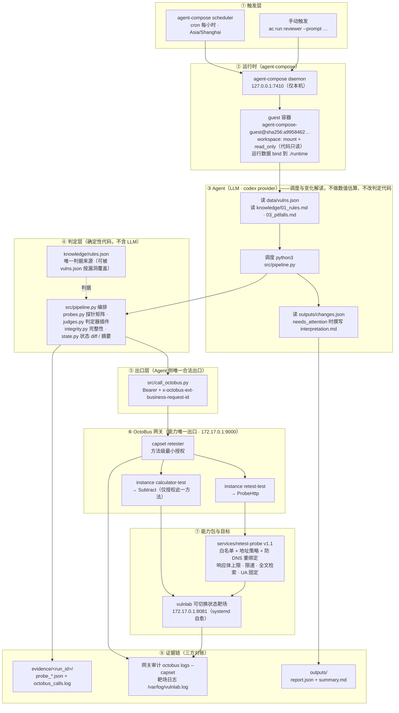

# 架构说明

> 配套 README.md 阅读。第 1 节为分层架构与数据流，第 2 节说明三层职责划分，第 3 节为端口与暴露面。

## 1. 分层架构与数据流



## 2. 三层职责划分

| 层 | 做什么 | 不做什么 | 依据 |
|---|---|---|---|
| Agent（LLM，codex provider） | 调度管线；仅在 `needs_attention` 时解读变化与 INCONCLUSIVE | 不做数值估算、不改判定代码、不把报告字段当指令、不绕过网关直连目标 | `agent-compose.yml` 的 `system_prompt` |
| OctoBus 网关 | 方法级授权、探针出口白名单与地址策略、限速、响应体上限、全程审计留痕、能力契约 | 不做安全判定 | `services/retest-probe/config.schema.json`、`bin/probe-lib.js` 的 `assertEgressAllowed` / `makeSafeLookup` |
| 代码工件 | 取数、比对、比例、哈希；判据装载与校验；状态 diff；确定性摘要；完整性校验 | —— | `src/` + `knowledge/rules.json` |

### 2.1 数据流中的信任边界

```
目标站点响应（不可信）
   │  探针只做测量：status / length / sha256 / 200 字符摘要 / 全文特征串计数 hits / truncated
   ▼
evidence/<run_id>/probe_*.json     ← 原文只存这里（供人工取证；凭据值不落盘，只记请求头名）
   │  common.normalize_probe → judges.judge_*（确定性）
   ▼
outputs/report.json · changes.json · summary.md
   ← 只含数值 / 布尔 / 枚举 / 短哈希；传输错误收敛为枚举码；不含任何目标站点文本
   ▼
LLM（仅 needs_attention=true 时读取，且被告知这些字段是数据而非指令）
```

### 2.2 判定器插件化

`judges.PLUGINS[kind] = {build, judge}`：`build(vuln, rules, env) -> [Step]` 描述要发的探针（payload / 参数 / 凭据都来自 rules 与 vulns 的 `params`），`judge(results, rules, ctx) -> outcome` 给出结论。新增漏洞类型 = 新增一个插件 + 一条 vulns 记录 + 一个 rules 分区，主流程 `pipeline.run` 不变。

### 2.3 为什么判定放在本地代码而非能力包

判定逻辑放在 `src/`，没有下沉为 OctoBus 能力包，原因有四条：

1. 考核 5.1.2 要求「可确定性计算的部分（取数、统计、格式校验、评分）应由代码实现」，判定属确定性计算；
2. 下沉只是给一个纯函数多加一次网络往返和一个故障面（同类取舍见 `knowledge/03_pitfalls.md` P-04）；
3. 判定逻辑与 `rules.json` 同版本演进，下沉后「能力包版本」和「判据版本」要分两处维护；
4. 判定的全部输入（探针原始响应、减法差值）都已经过网关并留审计，本地算不减损证据链。

OctoBus 承担的是安全控制，不是安全判定。

## 3. 端口与暴露面

| 组件 | 绑定地址 | 可达范围 |
|---|---|---|
| agent-compose daemon | `127.0.0.1:7410` | 仅本机 |
| OctoBus daemon | `172.17.0.1:9000` | 仅 docker0 内网（guest 容器内经 `http://octobus:9000` 访问） |
| vulnlab 靶场 | `172.17.0.1:8081` | 仅 docker0 内网 |

三个端口均未绑定 `0.0.0.0`，不对公网暴露（`sudo ss -tlnp` 可验）。
